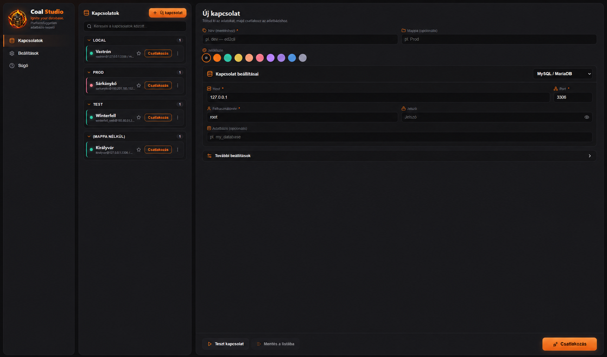
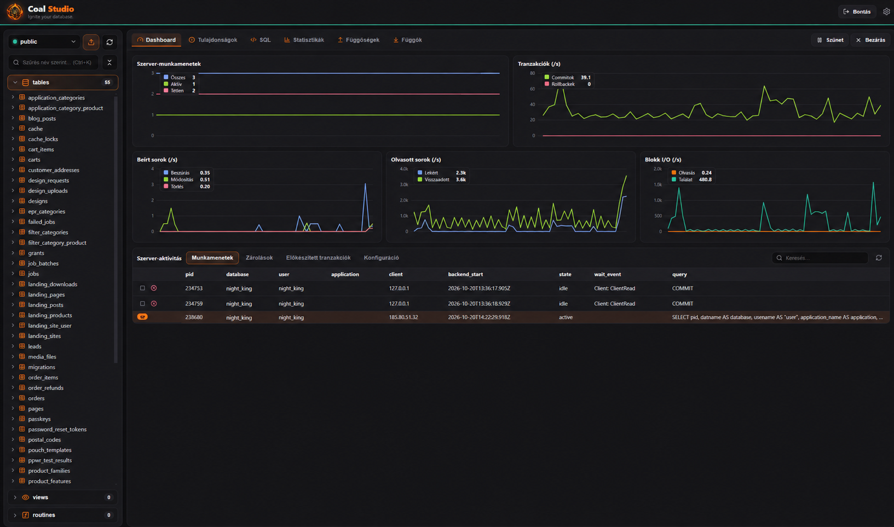
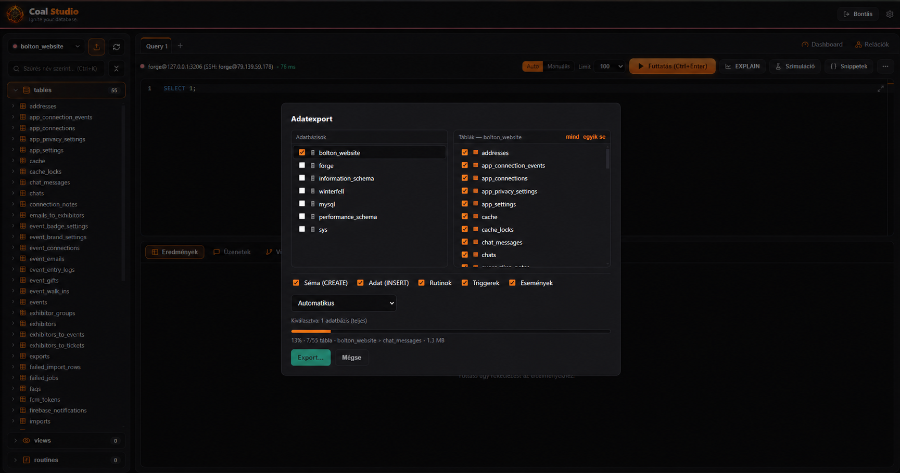
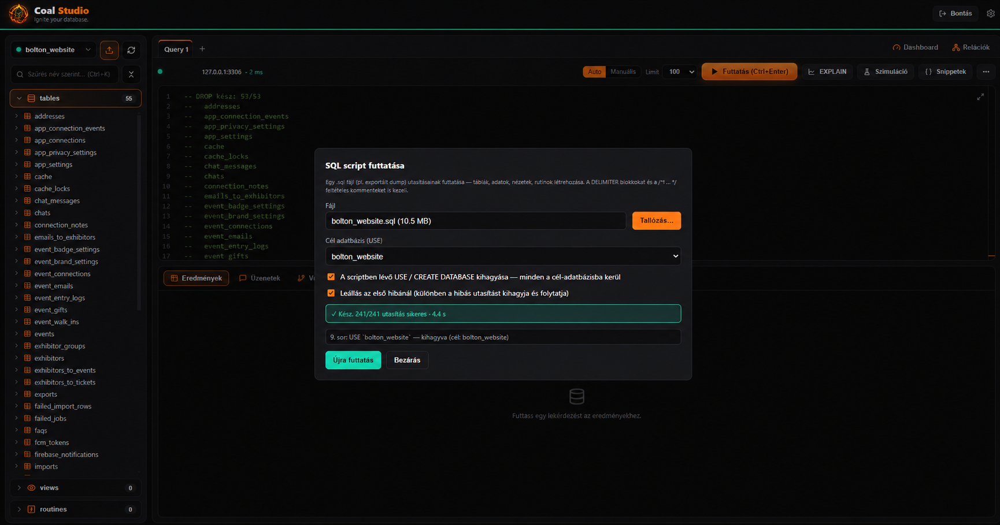

  

<h1 align="center">Coal SQL</h1>

  <b>Ignite your database.</b> 
  Platformfüggetlen adatbázis-kezelő asztali app — <b>Windows</b>, <b>macOS</b> és <b>Linux</b> alá. 
  Egy helyen több adatbázis-motor, SSH-tunnel, SQL-konzol, élő szerver-dashboard és séma-eszközök.

  <a href="../../releases/latest"><b>⬇ Legfrissebb verzió letöltése</b></a>

---

## Mit tud

**Csatlakozás bármihez**
- Több **adatbázis-motor**: MySQL / MariaDB, PostgreSQL és SQLite — egységes felületen.
- **SSH-tunnel** (kulcs vagy jelszó) a távoli, csak belső hálón elérhető szerverekhez.
- **Mentett kapcsolatok** mappákba rendezve, jelölőszínnel, kedvencekkel. A jelszavak az
  operációs rendszer **titkosított tárolójában** (safeStorage) pihennek.
- Gyors **Teszt kapcsolat** gomb, mielőtt elmentenéd.

**Lekérdezés és szerkesztés**
- **SQL-konzol** Monaco-szerkesztővel (ugyanaz, mint a VS Code-ban): kiemelés, automatikus
  kiegészítés, több utasítás futtatása.
- **Eredményrács**, és **Edit Data**: sorok szerkesztése, beszúrása, törlése kattintással
  (elsődleges kulcs alapján generált UPDATE/INSERT/DELETE).
- **Tranzakció-mód** (Auto / Manuális): BEGIN / COMMIT / ROLLBACK egy kattintással.
- **Séma-fa** oldalsáv kereséssel, több-kijelöléssel és tömeges művelettel (pl. DROP).

**Megértés és karbantartás**
- **Séma-szerkesztés** párbeszédekből: tábla / oszlop / index / idegen kulcs létrehozása és
  módosítása, **élő SQL-előnézettel** — látod, mit fog futtatni.
- **Gyors dokumentáció** (Ctrl+Q): DDL, statisztikák, becsült/pontos sorszám és az első sorok
  előnézete bármelyik objektumra.
- **ER-diagram**: táblák és idegenkulcs-kapcsolatok vizuálisan (phpMyAdmin Designer-stílus),
  automatikus elrendezéssel, pásztázással és zoommal.

**Üzemeltetés**
- **Dashboard + objektum-inspektor** (pgAdmin-stílus): élő grafikonok a tranzakciókról, írt/olvasott
  sorokról és a blokk-I/O-ról, valamint a szerver-aktivitás (munkamenetek, zárolások, előkészített
  tranzakciók, konfiguráció) — session-ök megszakíthatók/leállíthatók.
- **Dump & export**: több adatbázis és tábla egyetlen `.sql` fájlba (séma, adat, rutinok,
  triggerek, események külön választhatóan), natív `mysqldump` / `pg_dump`-pal vagy a beépített
  SQL-generálással (eszköz nélkül is) — **élő haladásjelzővel** (tábla, százalék, méret). Eredmények
  CSV / JSON exportja is.
- **SQL-script futtatás**: egy `.sql` dump visszatöltése motor-tudatos utasítás-bontással
  (DELIMITER-blokkok, `/*! … */` feltételes kommentek, `COPY … FROM stdin`), haladásjelzővel és
  megszakítással. Tetszőleges **cél-adatbázisba** tölthető: a scriptben lévő `USE` / `CREATE
  DATABASE` kihagyható, így egy dump egy másik nevű adatbázisba is visszaállítható.

## Letöltés és telepítés

Töltsd le a géped platformjának megfelelő fájlt a [**legfrissebb kiadásból**](../../releases/latest).

### Windows
Futtasd a **`coal-sql` NSIS telepítőt** (`.exe`), és kövesd a telepítőt.

- Az app még nincs kódaláírva, ezért a **böngésző** „veszélyes letöltésként” tilthatja (a letöltési
  listában: **⋯ → Megtartás**), és a **SmartScreen** is figyelmeztethet (**További információ →
  Futtatás mindenképp**). Ez aláíratlan appnál normális, nem valódi vírusjelzés.

### macOS
Nyisd meg a géped processzorának megfelelő **`.dmg`**-t, és húzd a **Coal SQL**-t az
*Applications* mappába.

- **`Coal SQL-<verzió>-arm64.dmg`** — Apple Silicon (M1 és újabb).
- **`Coal SQL-<verzió>-x64.dmg`** — Intel Mac.

Az app nincs Apple Developer ID-vel aláírva, ezért a macOS az első indítást blokkolja:
**jobbklikk az appon → Megnyitás → Megnyitás.** Utána már normálisan indul.

### Linux
**`.AppImage`** (tedd futtathatóvá, majd indítsd) vagy **`.deb`** (`sudo apt install ./...deb`).

## Jó tudni

- **Ez egy előzetes (preview) build, és 2026. december 31-én lejár.** Utána csak egy üzenetet
  mutat, amely új verzió letöltésére kér — az a [Releases](../../releases) oldalon lesz.
- A mentett kapcsolatok és beállítások a felhasználói profilodban tárolódnak, így túlélik a
  frissítéseket. Linuxon a jelszó-titkosításhoz a rendszer kulcstartója (libsecret/kwallet) kell.
- A *natív* dump funkcióhoz a `mysqldump` / `pg_dump` kell a PATH-on; enélkül a beépített
  SQL-generálás mindenhol működik.
